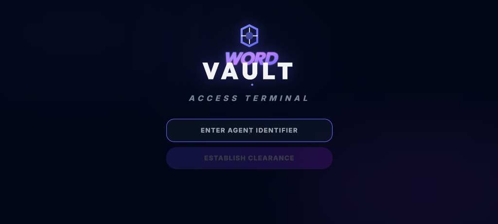
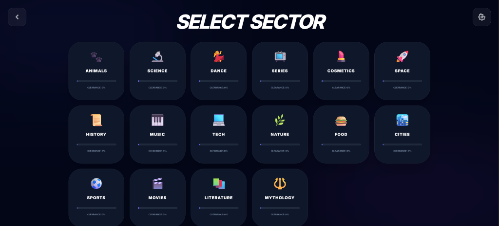
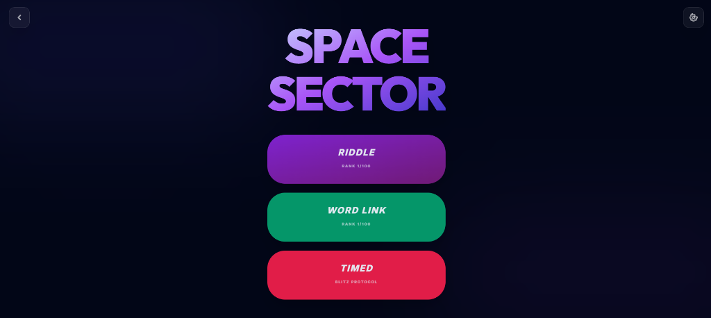
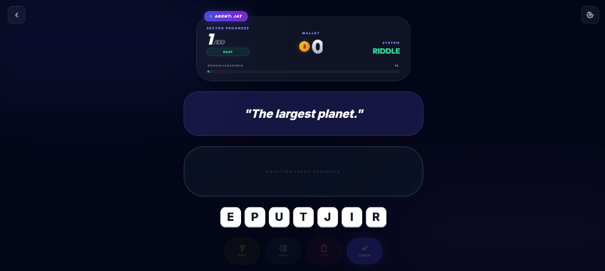

[README.md](https://github.com/user-attachments/files/33794964/README.md)

# 🔐 Word Vault — Cyberpunk Cryptography & Word Scramble Puzzle Game

## 🌐 Live Demo

🔗 https://vmvaishu.github.io/wordgmm/ *(or launch locally via Vite dev server)*

---

## 📋 Project Overview

**Word Vault** is an interactive, high-performance cyberpunk word puzzle and cryptography web application. Designed around a futuristic "Access Terminal" theme, players take on the persona of an authorized agent decrypting classified linguistic sequences across a multitude of specialized knowledge sectors.

The platform delivers an immersive, arcade-style experience featuring **procedural Web Audio sound synthesis, persistent agent profile management via `localStorage`, 17 thematic knowledge sectors, and multiple mission protocols (Riddle, Word Link, and Blitz Timed Mode)**.

---

## ✨ Features

* 🕵️ **Agent Clearance & Profile System**: Authenticate with unique Agent Identifiers, track daily streaks, and manage multiple profiles saved in browser `localStorage`.
* 🌌 **17 Specialized Knowledge Sectors**: Over 1,000+ curated words across Space, Tech, Mythology, Science, Literature, History, Food, Music, Sports, and more.
* 🎮 **3 Diverse Mission Protocols**:
  * **Riddle Decryption**: Unscramble letters using contextual hints and sector clues.
  * **Word Link**: Decipher interconnected thematic concepts.
  * **Timed Blitz Protocol**: High-octane 60-second countdown scramble testing rapid decryption reflexes.
* 🪙 **Credit Economy & Intel Hints**: Earn digital currency on successful decryptions; expend credits to reveal critical letter hints when stuck.
* 🔊 **Procedural Web Audio Engine**: Zero-asset, fully synthesized sound effects using the HTML5 Web Audio API (key clicks, success chords, alert buzzers, hint chimes, and level-up fanfares).
* 🎨 **Sleek Cyberpunk UI**: Built with a dark glassmorphic design, glowing neon gradients, animated SVG logos, and responsive typography (Inter & Outfit).
* 💥 **Dynamic Micro-Interactions**: Particle confetti celebrations on clears, tile reveal transitions, and shake animations on incorrect submissions.
* ⌨️ **Full Keyboard & Touch Support**: Play seamlessly using physical keyboard input (letters, Enter, Backspace) or on-screen interactive letter tiles.

---

## 🛠️ Tech Stack

* **Frontend:** React 19, TypeScript
* **Styling:** Tailwind CSS, Custom Keyframe Animations, Glassmorphic Design System
* **Audio Engine:** HTML5 Web Audio API (Custom Procedural Oscillator Synthesizer)
* **Build Tool:** Vite 6
* **State Management:** React Hooks (`useState`, `useEffect`, `useCallback`, `useRef`) & Browser `localStorage`
* **Icons & Vector Graphics:** Custom Inline SVG Vectors & Google Fonts (Inter, Outfit)

---

## ⚙️ How It Works

1. **Establish Clearance**: Input an Agent Identifier to access the vault or resume saved progress.
2. **Select Sector**: Choose an active sector (e.g., Space, Science, Mythology) displaying real-time clearance percentages.
3. **Choose Protocol**: Select your challenge mode—Riddle, Word Link, or Timed Blitz.
4. **Decipher Cryptograms**: Analyze the clue, inspect the randomized letter matrix, and construct the correct word via keyboard or clicking tiles.
5. **Progress & Ranks**: Complete levels to advance clearance rank from **Easy** to **Medium** to **Hard**, earning vault credits and extending daily streaks.

---

## 📁 Project Structure

```
wordgmm/
├── screenshots/
│   ├── 01-access-terminal.png
│   ├── 02-select-sector.png
│   ├── 03-sector-modes.png
│   └── 04-gameplay-riddle.png
├── components/
│   ├── GeneratedBanner.tsx
│   ├── LetterTile.tsx
│   └── ScorePanel.tsx
├── data/
│   └── words.ts
├── services/
│   └── audioService.ts
├── App.tsx
├── index.html
├── index.tsx
├── package.json
├── tsconfig.json
├── types.ts
└── vite.config.ts
```

---

## 🚀 How to Run Locally

### Prerequisites
* [Node.js](https://nodejs.org/) (version 18 or higher recommended)
* `npm` or `yarn`

### Installation & Setup

1. **Clone the repository**
```bash
git clone https://github.com/vmvaishu/wordgmm.git
```

2. **Navigate into the project directory**
```bash
cd wordgmm
```

3. **Install dependencies**
```bash
npm install
```

4. **Start the development server**
```bash
npm run dev
```

5. **Open your browser** and navigate to `http://localhost:5173`

---

## 📸 Screenshots

### 1. Access Terminal (Agent Authentication)


### 2. Sector Selection (16+ Knowledge Domains)


### 3. Sector Mission Protocols (Riddle, Word Link, Timed Blitz)


### 4. Decryption Interface (Interactive Riddle Gameplay)


---

## 💡 Key Learning Outcomes!


* **Component-Driven Game Architecture**: Structuring modular, scalable game states and input handlers in modern React with strict TypeScript typing.
* **Procedural Audio Programming**: Synthesizing custom sound effects on-the-fly using oscillators, gain nodes, and envelope decay without external audio files.
* **Client-Side Persistence**: Implementing resilient multi-user profile storage, streak tracking, and level progress caching via `localStorage`.
* **Cyberpunk Aesthetic & UX Design**: Crafting responsive, dark-mode futuristic interfaces with smooth CSS animations, neon glow filters, and accessible touch/keyboard controls.

---

## 🔮 Future Enhancements

* 🤖 **AI-Powered Riddle Generation**: Integrate Google Gemini API to generate limitless contextual clues and dynamic difficulty scaling.
* 🏆 **Global Terminal Leaderboard**: Cloud synchronization for cross-agent competitive rankings.
* ⚔️ **Multiplayer Head-to-Head**: Real-time duel protocol where two agents race to solve cryptograms simultaneously.
* 🎛️ **Audio Customizer & Themes**: Custom sound pitch toggles and alternate neon matrix color schemes.

---

## 👩‍💻 Author

**Vaishnavi V M**

* GitHub: [@vmvaishu](https://github.com/vmvaishu)
* LinkedIn: [Vaishnavi V M](https://www.linkedin.com/in/vaishnavi-v-m-83b9692)

---

## 🎯 Acknowledgement

This project was developed as an exploratory deep-dive into interactive web gameplay, procedural Web Audio engineering, and futuristic UI/UX design.

---
